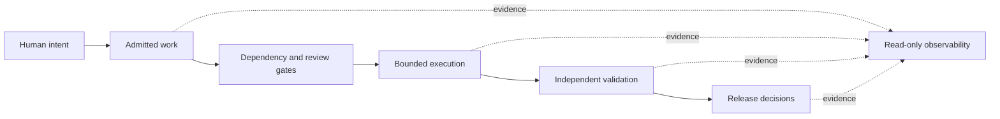

# Bebop — Engineering Reliability & Quality Showcase

**Andrew R. Cleveland | Senior Quality Engineering Leader | Regulated Banking & Medical Devices**

**Deterministic automation · Independent verification · Auditable release decisions · Failure-aware operations**

## Why this portfolio exists

I lead quality engineering organizations and remain hands-on with engineering. Across First Citizens Bank and Baxter/Hillrom, my professional experience has included QA strategy, Selenium/Playwright/UFT automation frameworks, enterprise testing services, structured banking UAT, regulated verification and validation, release criteria and globally distributed teams. [Professional experience and scope](docs/quality-leadership.md).

**Bebop is separate personal work.** It is a local-first research and engineering platform exploring how autonomous development can be made testable, bounded, auditable and operationally safe. The public code below includes curated, runnable excerpts and adaptations of private personal implementations plus one clearly labeled new synthetic release-gate illustration. It is not employer code, and these examples do not claim end-to-end autonomous production deployment.

## Start here: runnable engineering examples

| Example | Why it matters to quality engineering | Run |
| --- | --- | --- |
| [Versioned dependency contracts](examples/dependency-contract/) | Reject ambiguous requirements and prerequisites before work is admitted | `node --test examples/dependency-contract/*.test.mjs` |
| [Fail-closed evidence grading](examples/evidence-grading/) | Prevent a high aggregate score from hiding critical failures | `python -m unittest discover -s examples/evidence-grading` |
| [Truthful live-state caching](examples/live-state-cache/) | Expose stale, unauthorized, invalid or unavailable operational states | `node --test examples/live-state-cache/*.test.mjs` |
| [Evidence-based execution leases](examples/lease-policy/) | Detect tangible code/test progress rather than model activity | `python -m unittest discover -s examples/lease-policy` |
| [Synthetic release evidence gate](examples/release-gate/) | Model auditable READY/HOLD decisions based on traceable tests, CI, defects and UAT | `python -m unittest discover -s examples/release-gate` |

All examples use Node.js 22+ or Python 3.11+, have no third-party runtime dependencies and make no external network calls. The [public CI workflow](.github/workflows/examples.yml) runs each test suite.

## Engineering decisions and case studies

1. [Adversarial engineering evaluation](docs/02-adversarial-evaluation.md) — independent checks, negative testing, critical failure controls.
2. [Guarded delivery and release decisions](docs/01-guarded-delivery.md) — admission gates, authoritative state, SHA-pinned mutations.
3. [Trustworthy observability](docs/04-trustworthy-observability.md) — explicit failure states and truthful dashboards.
4. [Bounded agent execution](docs/03-bounded-execution.md) — evidence-based progress and non-negotiable hard limits.
5. [Reproducible local media experiments](docs/05-reproducible-experiments.md) — model/workflow provenance and experimental limits.

## Selected professional context (separate from Bebop)

- **Banking QA:** At First Citizens Bank, managed a 15-person test-services organization and helped establish structured UAT capabilities for teller and digital banking applications.
- **Regulated delivery:** At Baxter/Hillrom, lead a 50+ distributed engineering/quality organization serving a mission-critical clinical communications platform; quality work includes audit-ready verification, traceability and risk-based release decisions.
- **Automation and results:** Personally developed Selenium, Playwright and UFT test frameworks. Resume-reported outcomes include up to 40% shorter test cycles and automated first-run pass rates of 85%+.

These are career claims drawn from my resume, **not metrics measured by this public repository**. No confidential employer deliverables are reproduced.

## Architecture at a glance

*Logical architecture, not a live deployment map.*

**For hiring teams:** [Quality leadership and experience](docs/quality-leadership.md) · [Interview talking points](docs/resume-and-applications.md) · [Publication and provenance notes](docs/publication-notes.md). The complete operational repositories remain private. No general reuse license is granted by default.
