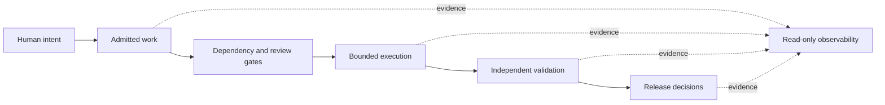

# Bebop — Selected Engineering Work

**Reliable automation · AI evaluation · execution safety · operational visibility**

Bebop is a personal, local-first engineering project investigating how autonomous coding and inference workflows can be made **testable, bounded, auditable, and safe to operate**. This is a curated engineering portfolio—not a dump of the private implementation or a claim that all planned features are deployed.

## Review the code

| Working excerpt | Design problem | Run it |
| --- | --- | --- |
| [Versioned dependency contracts](examples/dependency-contract/) | Prevent malformed dependencies from silently making a ticket eligible | `node --test examples/dependency-contract/*.test.mjs` |
| [Evidence-based execution leases](examples/lease-policy/) | Measure real Git/test progress instead of trusting model chatter | `python -m unittest discover -s examples/lease-policy` |
| [Fail-closed evaluation scoring](examples/evidence-grading/) | Prevent a high weighted score from concealing a critical failure | `python -m unittest discover -s examples/evidence-grading` |
| [Truthful live-state caching](examples/live-state-cache/) | Distinguish fresh, stale, invalid, unauthorized and unavailable data | `node --test examples/live-state-cache/*.test.mjs` |

Examples are runnable with **Node.js 22+ and Python 3.11+**, use only standard libraries, and make no network calls.

## Engineering case studies

1. [Guarded development and delivery](docs/01-guarded-delivery.md) — admission gates, dependency-aware scheduling, evidence validation, and safe mutation handling.
2. [Adversarial evaluation](docs/02-adversarial-evaluation.md) — independently checked AI coding results and reproducible grading.
3. [Bounded agent execution](docs/03-bounded-execution.md) — deterministic progress fingerprints and hard runtime limits.
4. [Honest observability](docs/04-trustworthy-observability.md) — API contracts and explicit degraded states.
5. [Reproducible media experimentation](docs/05-reproducible-experiments.md) — pinned model workflows and verified inputs.

## Conceptual architecture

*Logical component boundaries; not a live network map or claim of completed end-to-end unattended deployment.*

## For reviewers

Read [resume/application notes](docs/resume-and-applications.md) and [publication/provenance notes](docs/publication-notes.md) for project boundaries, technical discussion prompts and ready-to-use portfolio language.

The full source repositories, operational infrastructure, secrets, model weights, and private records remain private. This portfolio publishes carefully selected excerpts and adaptations with synthetic tests. No reuse license is granted by default.

**Portfolio URL:** https://github.com/arcleve05/bebop-showcase
